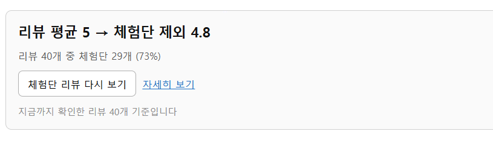
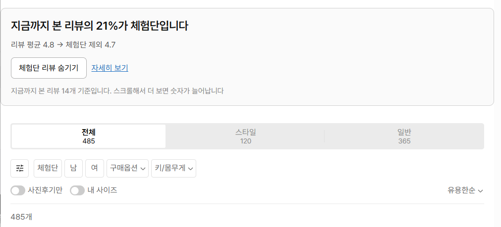
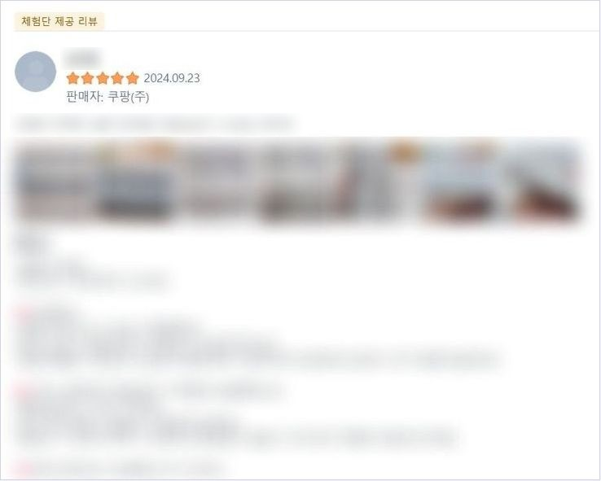
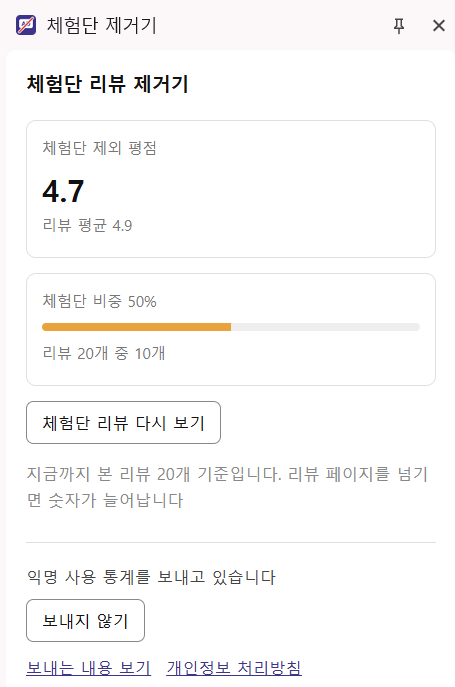

# 체험단 리뷰 제거기

쿠팡과 무신사 상품 페이지에서 체험단 리뷰에 표시를 붙이고, 버튼 하나로 숨기고, 체험단 리뷰를 뺀 평점을 보여 주는 크롬 확장입니다.

- 크롬 웹스토어: https://chromewebstore.google.com/detail/diefbidjmimlnigjmkdbghjdhokhhpdk
- 소개 페이지: https://crf-review-remover.vercel.app
- 개인정보 처리방침: https://crf-review-remover.vercel.app/privacy

## 화면

<table>
  <tr>
    <td width="50%"></td>
    <td width="50%"></td>
  </tr>
  <tr>
    <td>쿠팡: 리뷰 위 배너에 체험단을 뺀 평점과 비중</td>
    <td>무신사: 상품 페이지와 후기 전체보기에서도 같은 배너</td>
  </tr>
  <tr>
    <td align="center"></td>
    <td align="center"></td>
  </tr>
  <tr>
    <td>체험단 리뷰마다 표시가 붙고 버튼으로 숨깁니다</td>
    <td>사이드 패널에서 자세히 보고 여기서도 숨깁니다</td>
  </tr>
</table>

## 사용 방법

1. [크롬 웹스토어](https://chromewebstore.google.com/detail/diefbidjmimlnigjmkdbghjdhokhhpdk)에서 `크롬에 추가` 를 누릅니다
2. 설치 직후 열리는 화면에서 익명 사용 통계를 보낼지 고릅니다. 보내지 않아도 모든 기능을 씁니다
3. 쿠팡이나 무신사 상품 페이지를 열고 리뷰가 있는 곳까지 내립니다
4. 리뷰 위에 배너가 뜹니다. `체험단 리뷰 숨기기` 를 누르면 체험단 리뷰가 사라지고 `체험단 리뷰 다시 보기` 로 되돌립니다
5. 배너의 `자세히 보기` 나 툴바의 확장 아이콘을 누르면 사이드 패널이 열립니다
6. 더 많은 리뷰를 보면 숫자가 늘어납니다. 쿠팡은 리뷰 페이지를 넘기고, 무신사는 `후기 전체보기` 에서 스크롤합니다

알아 둘 것

- **판별 기준**: 쇼핑몰이 리뷰에 직접 붙이는 안내 문구가 있는 리뷰만 체험단으로 봅니다. 말투나 내용으로 추측하지 않습니다
  - 쿠팡: `쿠팡체험단 이벤트로 상품을 무료로 제공받아 작성한 구매 후기`
  - 무신사: `이 후기는 제품을 무상으로 제공받아 직접 사용해 본 후 작성되었습니다`
- **계산 범위**: 숫자는 상품 전체가 아니라 화면에서 본 리뷰를 누적한 값입니다. 확장은 쇼핑몰의 후기 목록을 따로 불러오지 않습니다
- **동작하는 곳**: 쿠팡 상품 페이지(`/vp/products/*`), 무신사 상품 페이지(`/products/*`)와 후기 전체보기(`/review/goods/*`). PC 크롬 전용입니다
- 무신사에서 `체험단` 조건을 직접 골라 체험단 후기만 모아 볼 때는 숨기지 않습니다
- 통계는 동의한 경우에만 보냅니다. 리뷰 내용, 상품 이름과 주소, 쇼핑몰 계정 정보는 보내지 않고, 상품 번호는 되돌릴 수 없는 값으로 바꿔 보냅니다. 자세한 내용은 [개인정보 처리방침](https://crf-review-remover.vercel.app/privacy)에 있습니다

## 버전

| 버전 | 게시 | 바뀐 것 |
|---|---|---|
| 1.1.0 | 2026-10-12 | 무신사 지원(상품 페이지, 후기 전체보기). 이름을 `체험단 리뷰 제거기` 로 변경. 사이드 패널에 숨기기 버튼. 배너와 패널에 "본 리뷰 기준, 더 보면 늘어남" 안내. 알리는 범위가 넓어져 이전 동의자에게 통계 동의를 다시 받음 |
| 1.0.0 | 2026-10-05 | 첫 공개. 쿠팡 지원. 이름은 `체험단 리뷰 제거기 for 쿠팡` |

## 기술 구성

| 영역 | 사용한 것 |
|---|---|
| 확장 | Chrome Extension Manifest V3, 순수 JavaScript(ES 모듈). 권한은 `storage`, `sidePanel` 두 개 |
| 번들 | esbuild (콘텐츠, 백그라운드, 사이드 패널, 설치 안내 화면의 네 번들) |
| 테스트 | Vitest, jsdom (테스트 1,497개) |
| 실브라우저 확인 | 크롬 헤드리스를 Chrome DevTools Protocol 로 직접 제어(`scripts/verify-musinsa.mjs`) |
| 계측 | Amplitude HTTP API V2. 동의한 경우에만 백그라운드에서 전송 |
| 실험 | 기기 번호를 해시해 변형을 고정 배정. 체험단 숨김 기본값, 배너 문구, 설치 안내의 예시 링크, 소개 페이지의 설치 버튼 배치 |
| 소개 페이지 | 정적 HTML, CSS, JavaScript. Vercel 배포(main 푸시 시 자동) |
| 이미지 | sharp (아이콘 PNG, 스토어와 소개 페이지 사진 가공) |
| 패키징 | fflate (허용 목록 기반 zip, 제출 전 점검) |

## 폴더 구조

```
.
├─ extension/                  크롬 확장(스토어에 올라가는 것)
│  ├─ manifest.json
│  ├─ icons/                   아이콘 SVG 원본과 PNG
│  └─ src/
│     ├─ core/                 순수 로직. 체험단 판별, 평점 계산, 실험 배정. DOM 을 모른다
│     ├─ content/              쇼핑몰 페이지 조작. 누적, 표시, 숨기기, 배너
│     │  └─ sites/             쇼핑몰별 부품(coupang.js, musinsa.js). 주소, 선택자, 문구, 정렬, 숨기는 방식
│     ├─ background/           이벤트 전송, 동의, 기기 번호, 탭별 요약
│     ├─ sidepanel/            사이드 패널 화면
│     ├─ onboarding/           설치 직후 통계 안내와 동의 화면
│     └─ shared/               이벤트 이름, 메시지, 설정
├─ site/                       소개 페이지, 처리방침, 제거 안내(Vercel)
│  ├─ public/                  HTML, CSS, 사진
│  └─ src/                     소개 페이지 스크립트(방문 계측, 실험, 모바일 넘기기)
├─ scripts/                    아이콘 생성, 사진 가공, 제출 패키지, 무신사 실브라우저 확인
├─ tests/                      Vitest 테스트와 픽스처
├─ docs/
│  ├─ superpowers/specs/       설계 명세
│  ├─ superpowers/plans/       단계별 구현 계획
│  ├─ research/                다른 쇼핑몰 지원 가능성 조사
│  ├─ store/                   스토어 등록 자료
│  └─ launch/                  홍보 채널별 링크와 글 초안
├─ dev/active/                 진행 상태와 다음 할 일
├─ build.js                    확장 번들 빌드
└─ vercel.json                 사이트 배포 설정
```

쇼핑몰이 화면을 바꾸면 `extension/src/content/sites/` 의 그 쇼핑몰 파일을 고칩니다. 새 쇼핑몰을 더할 때도 이 폴더에 파일 하나를 더하고 `sites/index.js` 와 매니페스트의 대상 주소에 넣습니다.

## 개발

빌드, 테스트, 크롬에 불러오기, 제출 패키지, 소개 페이지 배포 방법은 [docs/development.md](docs/development.md)에 있습니다.

## 문서

| 문서 | 내용 |
|---|---|
| `docs/superpowers/specs/2026-09-28-coupang-review-filter-design.md` | 설계. 6절 계측, 11절 동의와 최소 수집, 12절 소개 페이지, 13절 무신사 |
| `docs/superpowers/plans/` | 단계별 구현 계획 |
| `docs/research/2026-10-07-other-stores.md` | 무신사, 올리브영 지원 가능성 확인 |
| `docs/store/listing.md` | 스토어 등록 자료 |
| `docs/launch/channels.md` | 홍보 채널별 링크와 글 초안 |
| `docs/development.md` | 개발 방법 |
| `HANDOFF.md` | 인수인계: 구조, 완료한 일, 남은 일, 결정과 이유, 주의할 점 |

이 확장은 쿠팡, 무신사와 관계가 없는 개인이 만든 도구입니다.
